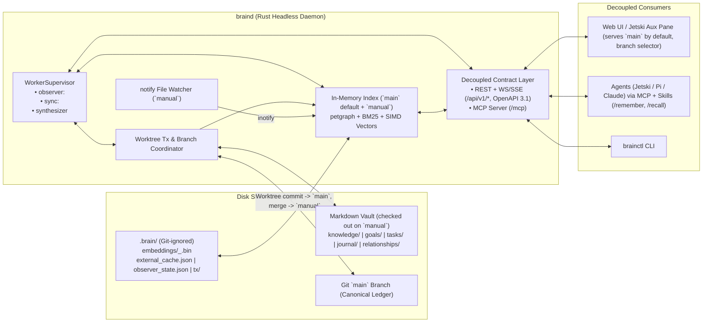

# Architecture Specification: Second Brain v2

## 1. System Overview

Second Brain v2 consists of a headless Rust daemon (`braind`) managing a Git-tracked Markdown vault on disk, an in-memory property graph and hybrid search index, and pluggable background workers. All human UIs (Web UI, Jetski Aux Pane, CLI) and AI agents (via MCP) are decoupled from `braind` through strict HTTP/WebSocket and MCP contracts.



## 2. Directory Layout

```
second-brain-v2/                # Root working tree checked out on branch `manual`
├── config.toml                 # Daemon config: embedding provider, harnesses, observers, sync sources
├── knowledge/                  # Durable concepts, insights, patterns, snippets (<slug>.md)
├── goals/                      # Long-term milestones and directions (<slug>.md)
├── tasks/                      # Actionable items (<slug>.md)
├── journal/                    # Daily episodic logs (YYYY-MM-DD.md)
├── relationships/              # People and organizations interacted with (<slug>.md)
├── .brain/                     # Git-ignored runtime caches & worktrees
│   ├── embeddings/             # Per-provider/model vector caches (<provider>_<model>.bin)
│   ├── external_cache.json     # Read-only external state namespaced by source (buganizer, critique, ...)
│   ├── observer_state.json     # Per-harness transcript cursors & per-session pushed-node dedup sets
│   └── tx/                     # Ephemeral transaction worktrees (.brain/tx/<tx_id>)
├── crates/
│   ├── braind/                 # Headless Rust daemon
│   └── brainctl/               # CLI & MCP stdio bridge
├── skills/
│   ├── remember/               # Explicit atomic capture skill
│   └── recall/                 # Explicit long-form deep search skill
└── docs/
    ├── spec/
    ├── adr/
    └── changes/
```

## 3. Git Branch & Worktree Transaction Topology (`manual` vs `main`)

1. **Root Working Directory (`manual` branch)**:
   - Remains checked out on `manual` so local manual file edits never conflict with `git update-ref` or worktree merges into `main`.
2. **Canonical Ledger (`main` branch)**:
   - Served by default on all Web UI and read API endpoints (`?branch=main|manual` allows switching between `main` and `manual`).
3. **Session-Scoped Ephemeral Worktrees (`.brain/tx/<tx_id>`)**:
   - Every `/remember` invocation or `synthesizer` batch creates a detached Git worktree at `.brain/tx/<tx_id>` rooted at `main` and records `owner_session_id`.
   - Subsequent writes/commits/aborts on `tx_id` verify `caller_session_id == owner_session_id` (best-effort session guard; returns `403 Forbidden` on mismatch).
   - Committing `tx_id` produces **1 atomic commit** (`remember: <summary>` or `synthesize: <summary>`) on `main`, merges `main` into `manual` (auto-committing overlapping dirty paths on `manual` first if any), removes `.brain/tx/<tx_id>`, and updates the in-memory index.
4. **Daily Stray Checkpoint**:
   - Once daily before running `synthesizer`, `braind` commits any uncommitted stray edits on `manual` (`chore(vault): daily stray checkpoint`) and merges `manual` $\to$ `main`.
5. **Commit-Granular Audit & Revert**:
   - Every `/remember` or `synthesizer` run is a single commit on `main` that can be reverted atomically via `POST /api/v1/audit/:sha/revert` (`git revert --no-edit <sha>` in a temporary worktree off `main`, followed by `manual` sync and index reload).

## 4. Decoupled API & Consumer Access Matrix

Read endpoints accept `?branch=main|manual` (default `main`).

| Endpoint | Method | Consumer Scope | Purpose |
|---|---|---|---|
| `/api/v1/tx` | `POST` | **Agent (MCP)** | Create `.brain/tx/<tx_id>` worktree off `main` bound to `owner_session_id`. |
| `/api/v1/tx/:tx_id/nodes` | `PUT / DELETE` | **Agent (MCP)** | Upsert/delete node in worktree (verifies `owner_session_id`). |
| `/api/v1/tx/:tx_id/commit` | `POST` | **Agent (MCP)** | Commit worktree $\to$ `main`, sync `manual`, update index (verifies `owner_session_id`). |
| `/api/v1/tx/:tx_id/abort` | `POST` | **Agent (MCP)** | Abort and remove `.brain/tx/<tx_id>` (verifies `owner_session_id`). |
| `/api/v1/search` | `GET` | **Both (UI & Agent)** | Tier-1 Heuristic Search (`?q=&types=&tags=&limit=&branch=`). |
| `/api/v1/search/deep` | `GET` | **Both (UI & Agent)** | Tier-2 Agentic Deep Search (`?q=&branch=`, spawns configured `HeadlessHarness`). |
| `/api/v1/nodes` | `GET` | **Both (UI & Agent)** | List/read nodes (`?branch=main\|manual`) + 1-hop edges + hydrated `bug`/`change` metadata. |
| `/api/v1/timeline` | `GET` | **Both (UI & Agent)** | Live Daily/Weekly view (`?branch=`): open `task` nodes (ordered by inherited `bug` P-level & `due`), synced Bugs/Changes, `journal`. |
| `/api/v1/nodes/:id` | `PUT / DELETE` | **Human / UI Only** | Direct single-node edit/delete on `manual` branch. |
| `/api/v1/graph` | `GET` | **Human / UI Only** | Full or filtered subgraph (`?branch=main\|manual`) for UI visualization. |
| `/api/v1/audit` | `GET` | **Human / UI Only** | Commit history (`?branch=main\|manual`) + diff stats + uncommitted stray edits on `manual`. |
| `/api/v1/audit/:sha/revert` | `POST` | **Human / UI Only** | Revert commit via worktree off `main`, sync `manual`, reload index. |
| `/api/v1/workers` | `GET / POST` | **Human / UI Only** | Inspect status/logs or pause/resume/trigger `observer:<harness>`, `sync:<source>`, and `synthesizer`. |
| `/api/v1/events` | `WS / SSE` | **Human / UI Only** | Real-time UI event stream (`TxCommitted`, `NodeUpdated`, `MemoryPushed`, `WorkerStateChanged`). |
